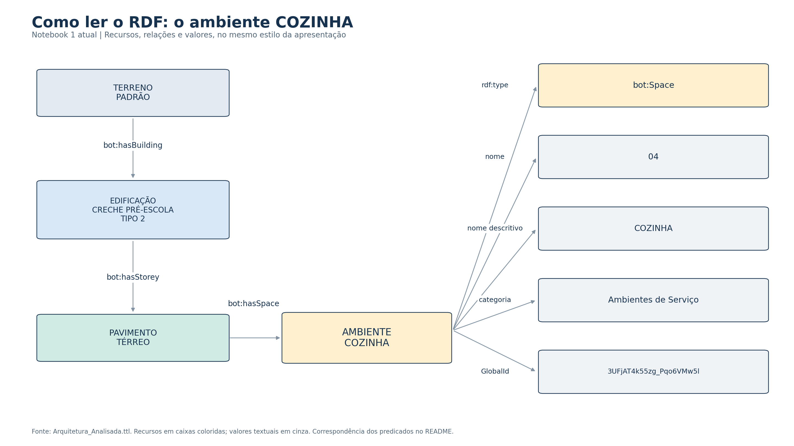
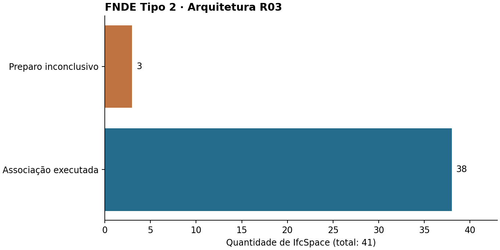
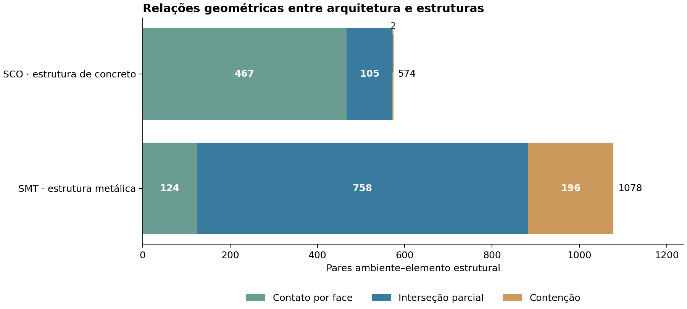

# BIM e grafos de conhecimento · CIV2155

**Trabalho aplicado à arquitetura e às estruturas do projeto FNDE Proinfância Tipo 2, revisão R03.**

O [Notebook 1](notebooks/01_Arquitetura_IFC_RDF.ipynb) converte a arquitetura IFC em RDF e acrescenta associações geométricas entre ambientes, paredes, aberturas e esquadrias. O [Notebook 2](notebooks/02_Integracao_Arquitetura_Estrutura.ipynb) aplica o mesmo extrator às estruturas e conecta seus elementos aos ambientes, preservando as fontes. O [Notebook 3](notebooks/03_Organizacao_e_Exploracao.ipynb) acrescenta organização semântica, consultas, validação e exploração integrada. Os três reúnem o procedimento executável, as explicações e as referências.

**Ver o RDF:** [Imagens em caixas](resultados/grafo_rdf/README.md) · [Explorar a aplicação](https://prcgui.github.io/bim-ontology-CIV2155/) · [Código da aplicação](visualizacao/README.md).

| Para conhecer o trabalho | Onde consultar |
|---|---|
| O que foi feito e como | [Método e alcance](docs/Metodo_e_Alcance.md) |
| Qual código foi usado | [Notebook 1](notebooks/01_Arquitetura_IFC_RDF.ipynb) · [Notebook 2](notebooks/02_Integracao_Arquitetura_Estrutura.ipynb) · [Módulos e consultas](codigo/README.md) |
| O que foi analisado | [Modelo IFC e pranchas R03](dados/README.md) · [Análise dos resultados](docs/Analise_dos_Resultados.md) |
| Quais resultados foram obtidos | [Arquitetura](resultados/README.md) · [Integração arquitetura e estrutura](resultados/integracao/README.md) |
| Quais fontes sustentam a implementação | [Referências utilizadas](referencias/README.md) |

**Resultado principal:** dos 41 espaços do IFC, 38 chegaram à associação geométrica e três permaneceram inconclusivos. Foram obtidos **101 pares ambiente–esquadria, envolvendo 66 esquadrias distintas**. Um elemento pode aparecer associado a mais de um ambiente.

Na amostra documental de 14 ambientes, foram recuperados 39 dos 43 casos positivos esperados (**90,7%**). Há uma omissão após a execução e três positivos sem resultado por falha de preparo. Esse percentual descreve a amostra usada no desenvolvimento, sem avaliação independente; não representa a acurácia de todas as associações do edifício.

Para executar, abra o notebook no [Google Colab](https://colab.research.google.com/github/prcgui/bim-ontology-CIV2155/blob/main/notebooks/01_Arquitetura_IFC_RDF.ipynb), ou instale as [dependências](requirements.txt) em Python 3.12 e execute as células na ordem. O preparo geométrico é refeito a partir do IFC. A conversão semântica já realizada é reutilizada por padrão; o notebook explica como repeti-la com Java 21.

Este repositório apresenta a rotina selecionada e os seus resultados. O [arquivo técnico no Google Drive](https://drive.google.com/drive/u/0/folders/1kVGXvERWXieeMeURrJF07tuLaADdrJ_O) reúne auditorias, testes, ensaios comparativos e versões anteriores. A reorganização da versão principal preserva o histórico de commits.

## Arquitetura e estruturas

O [Notebook 2](notebooks/02_Integracao_Arquitetura_Estrutura.ipynb) repete o extrator do N1 nos modelos ARQ, SMT e SCO, preserva o enriquecimento arquitetônico e reúne as fontes em cinco grafos nomeados. Foram observados **1.652 pares com relação geométrica**, envolvendo **1.333 elementos estruturais distintos**, nos 38 ambientes com sólido aceito. Os três inconclusivos permanecem sem contagem.

[Método e limitações da integração](docs/Integracao_Arquitetura_Estrutura.md) · [Resultados e Dataset RDF](resultados/integracao/README.md) · [Referências aplicadas, incluindo o novo artigo BOT](referencias/integracao/README.md) · [Abrir N2 no Colab](https://colab.research.google.com/github/prcgui/bim-ontology-CIV2155/blob/main/notebooks/02_Integracao_Arquitetura_Estrutura.ipynb).

## Organização e exploração dos resultados

O [Notebook 3](notebooks/03_Organizacao_e_Exploracao.ipynb) conserva os cinco grafos do N2 e acrescenta um perfil, o esquema BOT de referência, contexto de propriedades e proveniência da execução. O resultado contém **416.603 quádruplas em nove grafos**, oito consultas executadas e um contrato SHACL conforme na projeção documentada. Na viga V137, **9 conjuntos e 34 propriedades** foram recuperados com seus nomes, valores, tipos e unidades de origem.

[Explorador integrado](https://prcgui.github.io/bim-ontology-CIV2155/) · [Explorador N1 preservado](https://prcgui.github.io/bim-ontology-CIV2155/arquitetura-n1.html) · [Método e limites](docs/Organizacao_e_Exploracao.md) · [Resultados primários](resultados/organizacao/README.md) · [Referências aplicadas](referencias/organizacao/README.md) · [Abrir N3 no Colab](https://colab.research.google.com/github/prcgui/bim-ontology-CIV2155/blob/main/notebooks/03_Organizacao_e_Exploracao.ipynb).

A extensão melhora o contexto e a verificação das informações. Não demonstra aumento de acurácia geométrica ou ganho mensurado de usabilidade. Os três ambientes inconclusivos permanecem sem contagem.

## Limitações e requisitos para o artigo

A [matriz de limitações, evidências e requisitos](docs/Matriz_Limitacoes_e_Requisitos.md) relaciona dez dificuldades aos requisitos de informação da consulta pretendida, com referências e limites por caso. A [estrutura do artigo](docs/Estrutura_do_Artigo.md) organiza o raciocínio e distingue resultados demonstrados de recomendações ainda não testadas. O [rascunho assistido em Word e o material de redação](https://drive.google.com/drive/u/0/folders/1_0SFMbtcwTkfS2TFBsXS2E5VSXTXy5fJ) ficam no Drive; as revisões editoriais e os registros de conferência permanecem no arquivo técnico.
