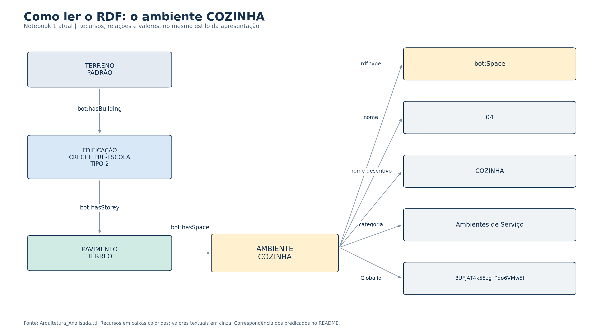
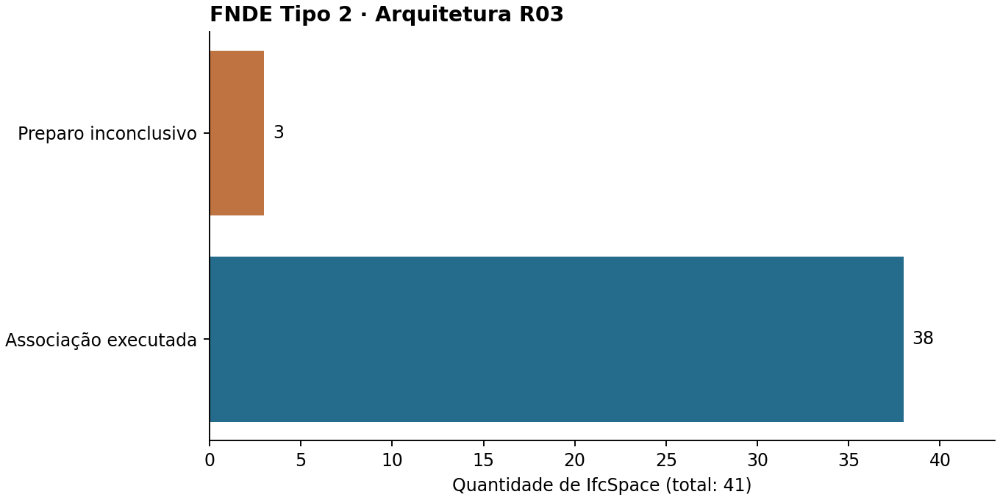
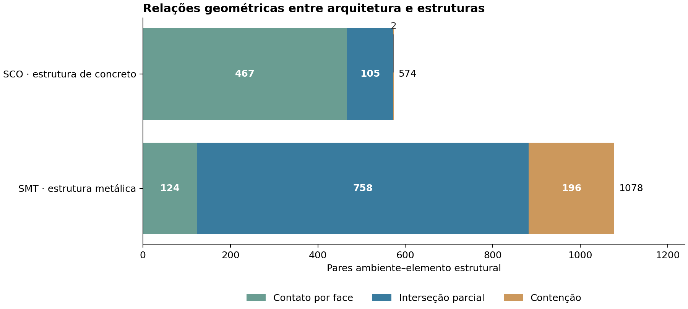

# BIM e grafos de conhecimento · CIV2155

**Trabalho aplicado à arquitetura e às estruturas do projeto FNDE Proinfância Tipo 2, revisão R03.**

O [Notebook 1](notebooks/01_Arquitetura_IFC_RDF.ipynb) converte a arquitetura IFC em RDF e acrescenta associações geométricas entre ambientes, paredes, aberturas e esquadrias. O [Notebook 2](notebooks/02_Integracao_Arquitetura_Estrutura.ipynb) aplica o mesmo extrator às estruturas e conecta seus elementos aos ambientes, preservando as fontes. O [Notebook 3](notebooks/03_Organizacao_e_Exploracao.ipynb) acrescenta organização semântica, consultas, validação e exploração integrada. Os três reúnem o procedimento executável, as explicações e as referências.

**Ver o RDF:** [Imagens em caixas](resultados/grafo_rdf/README.md) · [Explorar a aplicação](https://prcgui.github.io/bim-ontology-CIV2155/) · [Código da aplicação](visualizacao/README.md).

| Para conhecer o trabalho | Onde consultar |
|---|---|
| O que foi feito e como | [Método e alcance](docs/Metodo_e_Alcance.md) |
| Qual código foi usado | [Notebook 1](notebooks/01_Arquitetura_IFC_RDF.ipynb) · [Notebook 2](notebooks/02_Integracao_Arquitetura_Estrutura.ipynb) · [Notebook 3](notebooks/03_Organizacao_e_Exploracao.ipynb) |
| O que foi analisado | [Modelo IFC e pranchas R03](dados/README.md) · [Análise dos resultados](docs/Analise_dos_Resultados.md) |
| Quais resultados foram obtidos | [Arquitetura](resultados/README.md) · [Integração arquitetura e estrutura](resultados/integracao/README.md) |
| Quais fontes sustentam a implementação | [Referências utilizadas](referencias/README.md) |

**Resultado principal:** dos 41 espaços do IFC, 38 chegaram à associação geométrica e três permaneceram inconclusivos. Foram obtidos **101 pares ambiente–esquadria, envolvendo 66 esquadrias distintas**. Um elemento pode aparecer associado a mais de um ambiente.

A conferência documental foi ampliada aos **41 ambientes**. Das **122 relações positivas esperadas**, 100 foram recuperadas, 15 ficaram ausentes em oito ambientes processados e sete ficaram indisponíveis por falha no preparo de três espaços. A recuperação global foi **82,0%**; nos ambientes processados, **87,0%**. Das 101 associações produzidas, 100 concordaram com a referência e uma permaneceu indeterminada. A referência foi construída por leitura visual assistida por IA, sem revisão independente ou avaliação cega. [Resultados, evidências e limites](docs/Analise_dos_Resultados.md).

Para executar o N1, abra o notebook no [Google Colab](https://colab.research.google.com/github/prcgui/bim-ontology-CIV2155/blob/main/notebooks/01_Arquitetura_IFC_RDF.ipynb) e execute as células na ordem. O código Python do processamento, o vocabulário RDF e as consultas SPARQL estão dentro do próprio notebook, com explicação, referências, aplicação e limites junto a cada bloco. A pasta `codigo/` reúne somente os vocabulários, as consultas, as restrições e as atribuições para consulta separada. O notebook baixa os dados de entrada com versões fixadas, instala as bibliotecas e obtém o motor externo IFCtoLBD, identificado na etapa correspondente.

Os notebooks 2 e 3 seguem a mesma organização: funções Python, vocabulários próprios, consultas e restrições SHACL aparecem nas células, com descrição e referências por trecho. O N2 grava intermediários em `.execucao/notebook2` e resultados em `resultados/integracao`; o N3 usa `.execucao/notebook3` e `resultados/organizacao`. No Colab, essas pastas pertencem ao projeto `bim-ontology-CIV2155` do Drive. O N3 aceita uma nova execução do N2 após conferir os cinco grafos e as tabelas contra a referência semântica declarada, registrando o hash do ZIP efetivamente recebido.

Os artefatos de resultados publicados são a referência preservada do estudo. As saídas salvas nos notebooks 2 e 3 registram a reexecução local da versão com código nas células, incluindo a sequência N2 para N3, com seus próprios hashes e tempos. Os pacotes dessa reexecução e os comprovantes estão no arquivo técnico do Drive.

O padrão `RECONVERTER=True` refaz a conversão semântica desde o IFC original, com Java 21, e as etapas seguintes refazem o preparo e as associações geométricas. A opção `False` reutiliza explicitamente a base publicada. As paredes são preparadas em sequência para permitir a execução das funções diretamente nas células. No Colab, a etapa 1.1 conecta o Drive e usa as pastas oficiais `Meu Drive/bim-ontology-CIV2155/.execucao` e `Meu Drive/bim-ontology-CIV2155/resultados`. O ZIP é gravado em `resultados/Resultados_Notebook1.zip` e também fica disponível para download. Para execução local, use Python 3.12 e as [dependências](requirements.txt).

Este repositório apresenta a rotina selecionada e os seus resultados. O [arquivo técnico no Google Drive](https://drive.google.com/drive/u/0/folders/1kVGXvERWXieeMeURrJF07tuLaADdrJ_O) conserva as evidências de execução e de escolha do método que sustentam os resultados atuais. Os arquivos de uso não incluem versões antigas dos notebooks. O histórico de commits é preservado.

## Arquitetura e estruturas

O [Notebook 2](notebooks/02_Integracao_Arquitetura_Estrutura.ipynb) repete o extrator do N1 nos modelos ARQ, SMT e SCO, preserva o enriquecimento arquitetônico e reúne as fontes em cinco grafos nomeados. Foram observados **1.652 pares com relação geométrica**, envolvendo **1.333 elementos estruturais distintos**, nos 38 ambientes com sólido aceito. Os três inconclusivos permanecem sem contagem.

[Método e limitações da integração](docs/Integracao_Arquitetura_Estrutura.md) · [Resultados e Dataset RDF](resultados/integracao/README.md) · [Referências aplicadas, incluindo o novo artigo BOT](referencias/integracao/README.md) · [Abrir N2 no Colab](https://colab.research.google.com/github/prcgui/bim-ontology-CIV2155/blob/main/notebooks/02_Integracao_Arquitetura_Estrutura.ipynb).

## Organização e exploração dos resultados

O [Notebook 3](notebooks/03_Organizacao_e_Exploracao.ipynb) conserva os cinco grafos do N2 e acrescenta um perfil, o esquema BOT de referência, contexto de propriedades e proveniência da execução. O resultado contém **416.603 quádruplas em nove grafos**, oito consultas executadas e um contrato SHACL conforme na projeção documentada. Na viga V137, **9 conjuntos e 34 propriedades** foram recuperados com seus nomes, valores, tipos e unidades de origem.

[Explorador integrado](https://prcgui.github.io/bim-ontology-CIV2155/) · [Explorador N1 preservado](https://prcgui.github.io/bim-ontology-CIV2155/arquitetura-n1.html) · [Método e limites](docs/Organizacao_e_Exploracao.md) · [Resultados primários](resultados/organizacao/README.md) · [Referências aplicadas](referencias/organizacao/README.md) · [Abrir N3 no Colab](https://colab.research.google.com/github/prcgui/bim-ontology-CIV2155/blob/main/notebooks/03_Organizacao_e_Exploracao.ipynb).

A extensão melhora o contexto e a verificação das informações. Não demonstra aumento de acurácia geométrica ou ganho mensurado de usabilidade. Os três ambientes inconclusivos permanecem sem contagem.

## Limitações e requisitos para o artigo

A [matriz de limitações, evidências e requisitos](docs/Matriz_Limitacoes_e_Requisitos.md) relaciona dez dificuldades aos requisitos de informação da consulta pretendida, com referências e limites por caso. A [estrutura do artigo](docs/Estrutura_do_Artigo.md) organiza o raciocínio e distingue resultados demonstrados de recomendações ainda não testadas. O [documento em Word e o material de redação](https://drive.google.com/drive/u/0/folders/1_0SFMbtcwTkfS2TFBsXS2E5VSXTXy5fJ) ficam no Drive; as revisões editoriais e os registros de conferência permanecem no arquivo técnico.

## Documentos finais

| Documento | Arquivos oficiais | Conteúdo conferido |
|---|---|---|
| Artigo | `Artigo_BIM_Consolidado.docx` e `Artigo_BIM_Consolidado.pdf` | 12 páginas, três figuras, duas tabelas e oito referências. |
| Relatório visual | `Conferencia_Visual_Por_Ambiente.docx` | 517 páginas, 258 fichas, 41 ambientes e 345 casos selecionados. |

A [pasta de artigo e relatório no Drive](https://drive.google.com/drive/u/0/folders/1_0SFMbtcwTkfS2TFBsXS2E5VSXTXy5fJ) é o destino dos documentos finais. O relatório relaciona os grafos às vistas dos modelos BIM; a seleção visual de 345 casos não constitui revisão exaustiva dos 1.753 pares RDF do controle quantitativo. As imagens estão incorporadas ao documento, e os sete grafos densos usam recortes identificados dos casos RDF selecionados.

Os documentos Word/PDF, as fontes de montagem visual, os backups e as auditorias permanecem no Drive; o [arquivo técnico](https://drive.google.com/drive/u/0/folders/1kVGXvERWXieeMeURrJF07tuLaADdrJ_O) conserva os controles detalhados. O repositório mantém os três notebooks finais, os resultados primários e o [recorte GraphDB da Cozinha e da V137](resultados/organizacao/README.md#recorte-visual-da-cozinha-e-da-viga-v137).
