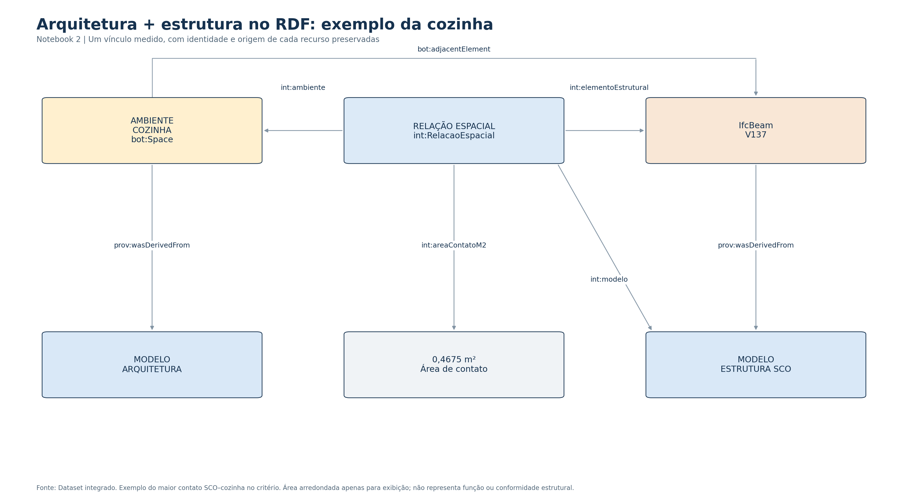

# Integração de arquitetura e estrutura

O [Notebook 2](../notebooks/02_Integracao_Arquitetura_Estrutura.ipynb) aplica o mesmo extrator do Notebook 1 à arquitetura, à estrutura metálica (SMT) e à estrutura de concreto (SCO), todos FNDE Tipo 2 R03. A base arquitetônica reextraída deve estar contida no resultado enriquecido do N1. Seus 80.234 enunciados e 101 pares ambiente–esquadria são preservados.

## Método aplicado

1. Conferir os bytes dos três IFCs por SHA-256, sem alterar os originais.
2. Converter cada modelo com o IFCtoLBD 2.49.0 e as mesmas correções textuais do N1. Preservar GlobalIds e nomes; usar namespaces separados para evitar colisões.
3. Aplicar os placements das fontes e expressar a geometria em metros. ARQ usa metros, SMT milímetros e SCO centímetros. O deslocamento de −40 m em X do terreno SCO já faz parte de seus placements e não é aplicado duas vezes.
4. Preparar os espaços com as mesmas guardas conservadoras do N1. Selecionar 5.329 elementos estruturais físicos no recorte e pré-filtrar pares por AABB.
5. Operar nos sólidos: volume comum para contenção/interseção, superfície comum para adjacência. Aresta, ponto ou mera proximidade não geram contato por face. Nenhuma caixa substitui um sólido inconclusivo.
6. Manter os modelos em grafos nomeados, com vínculos e proveniência em contextos próprios. Consultar os modelos conjuntamente e conferir a preservação semântica após serializar/reabrir o N-Quads.

O fluxo de checagem adapta Lilis et al. (2025); a implementação OCP e seus limiares são próprios. Os predicados são fundamentados em Rasmussen et al. (2021), artigo adicional disponibilizado com as [referências aplicadas](../referencias/integracao/README.md). A federação segue RDF Datasets do W3C.

## Resultados observados

| Indicador | Resultado |
|---|---:|
| Produtos IFC identificados no RDF | 26.601 |
| Espaços arquitetônicos | 41 |
| Espaços com sólido aceito / inconclusivos | 38 / 3 |
| Elementos no recorte geométrico | 5.329 |
| Pares candidatos examinados | 2.053 |
| Pares com relação positiva | 1.652 |
| Elementos estruturais distintos nesses pares | 1.333 |
| Interseção parcial / contenção / contato por face | 863 / 198 / 591 |
| Relações SMT / SCO | 1.078 / 574 |
| Quádruplas no Dataset | 415.175 |

Os 38 espaços preparados têm pelo menos uma relação positiva. Isso demonstra que a rotina percorreu o conjunto preparado; não constitui taxa de acerto arquitetônico ou estrutural. Na cozinha há 16 relações SCO: 15 contatos por face e uma interseção parcial; não houve relação SMT pelo critério. Um elemento pode aparecer em vários pares.

## Limitações que permanecem

| Problema | Tratamento e limite |
|---|---|
| Infantil 1, Infantil 5 e Amamentação sem sólido aceito | Contagens indisponíveis, não zero. Não recebem vínculos presumidos. |
| Ausência de MapConversion e de conferência externa de alinhamento | Os placements e unidades declarados são aplicados. A coincidência geométrica no referencial dos arquivos não prova o alinhamento topográfico entre disciplinas. |
| Pavimentos e entidades com nomes/cotas diferentes | Não se estabelece identidade por nome, cota ou proximidade. Os recursos permanecem separados; não se infere `owl:sameAs`. |
| Recorte geométrico | 17.755 armaduras SCO, 1.365 assemblies SMT e 27 features de vazios SMT não são examinados como peças independentes. Permanecem na extração semântica. |
| Ausência de referência independente para os 1.652 vínculos | Não há estimativa de precisão/recall desses vínculos nem classificação de erro de projeto. Contato/interseção não determina função ou adequação estrutural. |
| Representação, tolerâncias e sobreposição dos espaços | A validade de um sólido não elimina sobreposições entre espaços da fonte. Os limiares podem afetar relações próximas dos limites. A harmonização geral das propriedades não foi realizada. |

São limitações desta execução, não uma afirmação de impossibilidade na literatura. [Tabelas, consultas e Dataset completos](../resultados/integracao/README.md). Ensaios analíticos, falhas investigadas e registros de execução ficam apenas no [arquivo técnico do Drive](https://drive.google.com/drive/u/0/folders/1kVGXvERWXieeMeURrJF07tuLaADdrJ_O).
