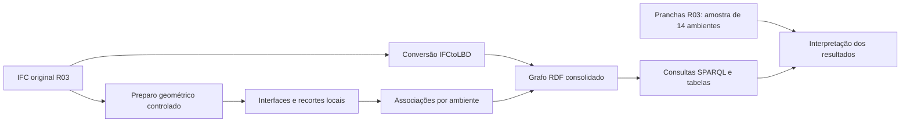

# Procedimento executado

**Objetivo:** representar em um grafo consultável os ambientes e as associações locais com paredes, aberturas e esquadrias do modelo arquitetônico FNDE Tipo 2 R03.

1. **Importar o IFC e preservar a identidade.** Conferir o arquivo original por SHA-256. A conversão IFCtoLBD 2.49.0 produz entidades e propriedades em RDF. A correção de leitura textual preserva acentos e apóstrofos. A base convertida é reutilizada explicitamente; pode ser produzida novamente pelo mesmo código.
2. **Preparar os espaços.** Construir sólidos a partir das faces originais. Quando o caminho estrito falha, tentar ShapeFix e costura em cópia da geometria, com tolerâncias de 1, 10 e 100 µm. Exigir uma casca fechada, validade, volume positivo e preservação geométrica. Nove espaços foram recuperados; três não satisfizeram as condições. O IFC não é regravado.
3. **Preparar paredes e aberturas.** Compartilhar o preparo de cada parede entre os ambientes. Usar as relações declaradas de abertura/preenchimento e manter a ancestralidade dos recortes. O sólido de uma abertura só é constituído das suas próprias faces e precisa ser válido. Recortes que extrapolam a face parental são recusados.
4. **Encontrar interfaces locais.** Pré-filtrar por caixas envolventes; cruzar faces planas com normais opostas e distância de até 0,1 mm. A normalização planar controla apenas desvios numéricos de até 0,1 mm e preserva anéis. As interseções são polígonos 3D no referencial do IFC.
5. **Qualificar e associar.** Aplicar raios e sondas locais de 1 mm no sólido do espaço. Vincular o recorte da abertura à interface qualificada e ao preenchimento declarado. Apenas IfcDoor e IfcWindow entram na tabela de esquadrias. Candidatos internos e componentes próximos calculados pelo núcleo não recebem afirmação de contenção ou função arquitetônica no grafo apresentado.
6. **Integrar e consultar.** Acrescentar resultados às 56.961 triplas da conversão semântica. Preservar GUIDs/URIs, estado de execução e polígonos. Consultar o grafo reaberto com SPARQL para obter ambientes e associações. Nos três ambientes inconclusivos, a contagem de esquadrias fica ausente.
7. **Interpretar os resultados.** Separar a execução sobre 41 espaços da análise documental de 14 ambientes. Informar omissões, limitações e divergências, sem promover falta de resultado a exclusão correta.

A associação primária não usa a referência documental como entrada nem altera tolerâncias pelo nome do ambiente. A amostra, porém, foi consultada durante o desenvolvimento e a investigação de falhas; não é um conjunto de avaliação cega. Os métodos, bibliotecas e adaptações estão em [Referências utilizadas](../referencias/README.md).
