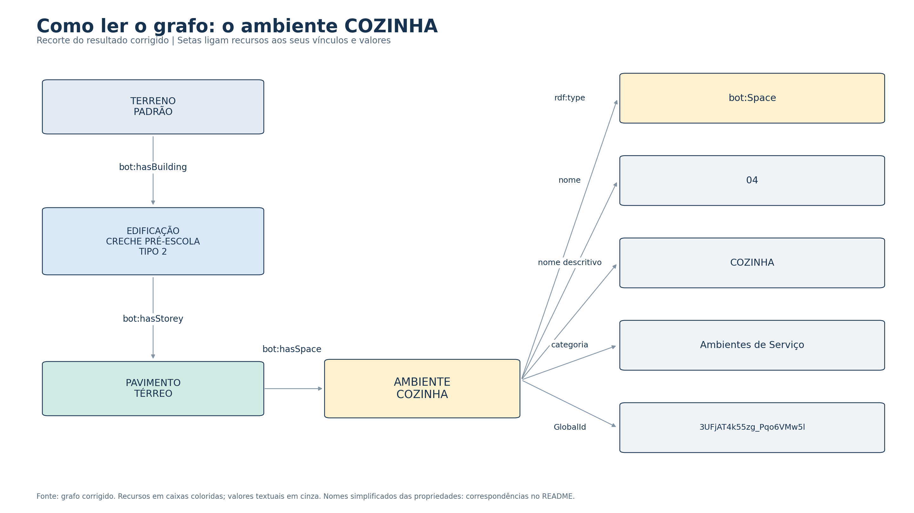
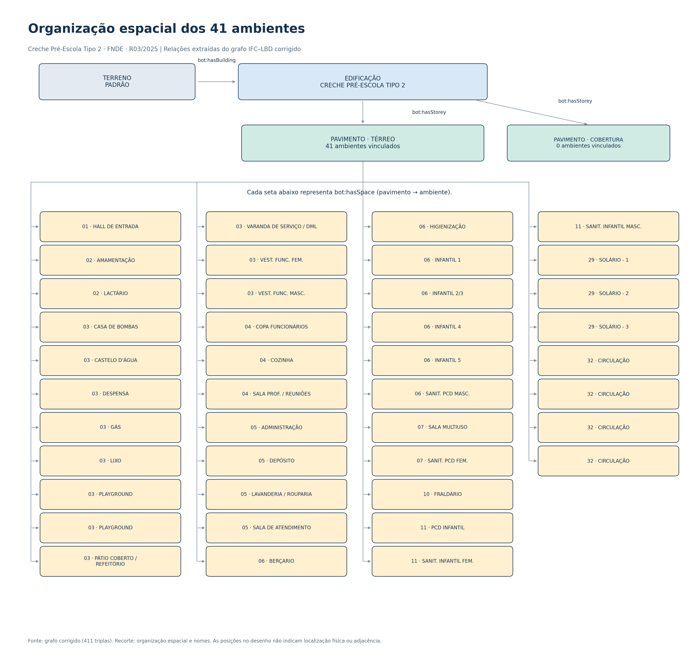

# Resultados

## Lilis no código híbrido da cozinha

O [ensaio parcial executado](lilis_hibrido_v01/) adapta projeção, interseção e subtração de polígonos a partir de Lilis et al. (2026). Mantém dez aberturas distintas; produz 12 recortes candidatos, com 11 apoiados pelo volume 3D e um adicional de 0,062 m² por projeção. Os 20 controles passaram. O RDF preserva 2.559 triplas e passa a 3.244. A contribuição observada é geométrica e comparativa, sem melhora de acurácia arquitetônica demonstrada. Alpha wrap e validação arquitetônica permanecem pendentes. [Notebook 9 executado](../notebooks/09_Lilis_Hibrido_Cozinha_v01.ipynb) · [Notebook 1 v07](../notebooks/01_Conversao_Arquitetura_IFC_LBD_v07.ipynb).

## Inspeção de portas, aberturas e hospedeiros

Os [resultados do notebook 3](notebook3/) registram 53 portas e seus pares hospedeiro-porta no RDF. O filtro inicial reconhece 45 hospedeiros `IfcWall`; os oito casos restantes estão associados a dois objetos `IfcFurniture` descritos como divisórias de granito. Os 53 pares aparecem no RDF. O recorte descreve uma limitação do critério de consulta e não demonstra perda de conversão. O notebook, as entradas e o relatório detalham os critérios e os limites dessa conclusão.

Resultados consolidados da análise, respostas às consultas, tabelas e evidências de comparação entre os dados IFC e a representação semântica.

## Diagnóstico entre arquitetura e estrutura

O [notebook 2 e suas evidências](notebook2/) ampliam a análise aos elementos da arquitetura e ao IFC estrutural SMT. As conversões foram concluídas separadamente, com preservação dos identificadores e textos comparados. Permanecem divergências no critério de recuperação dos vínculos com pavimentos e decisões de correspondência entre os modelos. A etapa encerra-se no registro dessas pendências, sem aplicar soluções de integração.

## Visualização do grafo

As figuras foram extraídas do grafo corrigido de 411 triplas e apresentam dois recortes complementares. Os arquivos SVG permitem ampliar o desenho preservando a nitidez dos textos.

### Detalhe das relações e propriedades de um ambiente

[Abrir imagem em alta resolução](visualizacao_grafo/grafo_detalhe_cozinha.png) · [Versão vetorial SVG](visualizacao_grafo/grafo_detalhe_cozinha.svg)

### Organização espacial dos 41 ambientes

[Abrir imagem em alta resolução](visualizacao_grafo/grafo_organizacao_espacial.png) · [Versão vetorial SVG](visualizacao_grafo/grafo_organizacao_espacial.svg)

As setas representam relações presentes no resultado IFC–LBD. A disposição das caixas facilita a leitura e não representa localização física ou adjacência. A cobertura não apresenta ambientes vinculados neste grafo. Os nomes podem se repetir; a identidade dos ambientes é determinada pelo `GlobalId` e pela URI. O [registro das figuras, as correspondências das propriedades e os arquivos RDF utilizados](visualizacao_grafo/) permitem conferir os recortes.

## Efeito da correção de leitura textual

Foram comparadas duas execuções sobre o mesmo arquivo `TIPO2-ARQ-DTV_R03.ifc`: a distribuição IFCtoLBD 2.49.0 e uma execução com correções locais em duas funções de leitura textual. Os parâmetros de conversão foram mantidos. A intervenção e sua autoria estão descritas na [célula 8](../consultas/08_correcao_textual_conversor.py); os critérios de comparação constam da [célula 9](../consultas/09_comparacao_apos_correcao.py).

A comparação utiliza os mesmos 41 ambientes, pareados por `GlobalId`, e igualdade textual exata, sem normalização dos valores.

| Campo | Preservados na execução original | Divergentes na execução original | Preservados após a correção | Divergentes após a correção |
| --- | ---: | ---: | ---: | ---: |
| `Name` | 41 | 0 | 41 | 0 |
| `LongName` | 28 | 13 | 41 | 0 |
| `Pset_SpaceCommon.Category` | 28 | 13 | 41 | 0 |

As 26 divergências textuais examinadas foram eliminadas após a intervenção. Os 41 identificadores e as 41 relações entre ambientes e pavimentos foram preservados. O grafo manteve 411 triplas e atendeu às mesmas regras SHACL. O apóstrofo em `CASTELO D'ÁGUA` também foi preservado. Os dez testes independentes das funções corrigidas foram aprovados antes da conversão completa.

O resultado caracteriza a fidelidade dos campos selecionados nesta base e nesta configuração. As classificações formais do IFC foram inventariadas separadamente; a preservação da categoria funcional não equivale à preservação de todas as classificações ou de todo o conteúdo do modelo.

- [Comparação completa antes/depois, 246 registros](correcao_textual/comparacao_antes_depois.csv).
- [Resumo por campo e execução](correcao_textual/resumo_antes_depois.csv).
- [Avaliação da correção](correcao_textual/avaliacao_correcao.json).
- [Fontes, comandos, hashes e parâmetros utilizados](correcao_textual/registro_correcao.json).
- [Diferença exata em relação ao código dos autores](correcao_textual/alteracoes.patch).
