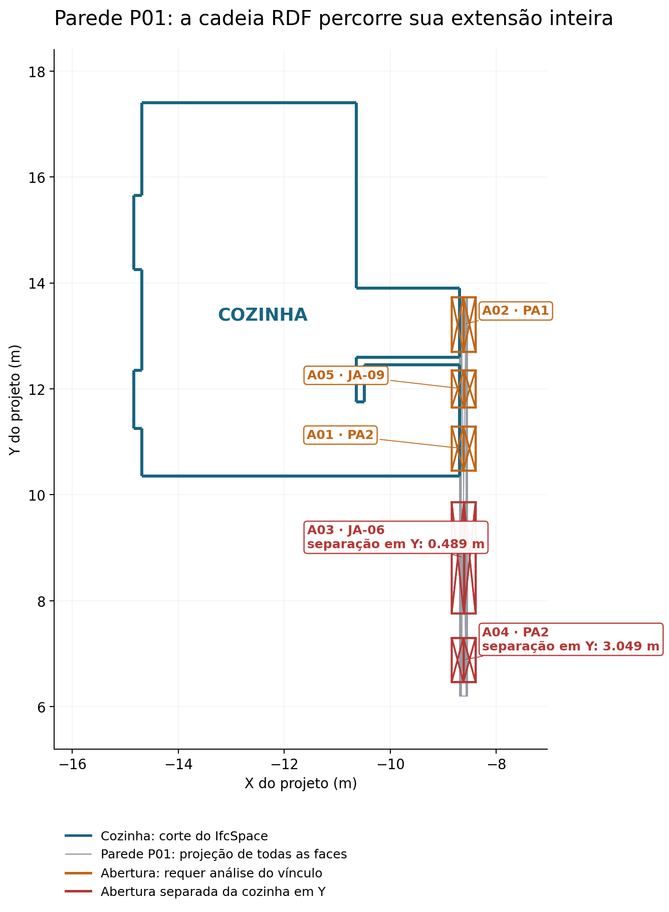

# Conferência da cozinha no IFC e no RDF

[Notebook 4 executado](../../notebooks/04_Conferencia_Cozinha_IFC_RDF_v01.ipynb) · [Relatório de cinco páginas](Conferencia_Cozinha_IFC_RDF_v01.pdf) · [Matriz de rastreabilidade v02](../matriz_rastreabilidade_v02/CIV2155_Matriz_de_Rastreabilidade_v02.xlsx) · [Código](../../consultas/conferencia_cozinha_v01/).

## Resultado

As 14 linhas da consulta (oito cadeias com abertura e seis paredes sem abertura) coincidem com as relações declaradas no IFC para as dez paredes selecionadas. Os preenchimentos são quatro portas, três janelas e uma parede. Essa fidelidade não demonstra que todos atendam à cozinha.

- **A03 / JA-06:** abertura separada da caixa da cozinha por 0,488767 m em Y.
- **A04 / PA2:** abertura separada por 3,049418 m em Y.
- **Cobertura:** 21 aberturas pré-selecionadas entre as 184 do IFC; quinze sem hospedeiro na lista das dez paredes. Quatro aberturas de janelas pertencem à parede excluída por sobreposição volumétrica com a cozinha. São candidatos para diagnóstico, não quinze vínculos arquitetônicos confirmados.

## Procedimento

O notebook confere hashes, recupera o ambiente por GUID, percorre IfcRelVoidsElement/IfcRelFillsElement, compara tuplas IFC–RDF e examina a localização por malhas 3D. As caixas só pré-selecionam candidatos ou fornecem testemunho de separação; sua sobreposição não confirma vínculo. Os cortes e projeções são extraídos das malhas, não plantas oficiais ou grafos desenhados manualmente.

[SPARQL executada](consulta_conferencia_cozinha.rq) · [Oito cadeias e diagnóstico](aberturas_e_preenchimentos_conferencia.csv) · [Dados, GUIDs e números STEP](conferencia_cozinha_dados.json) · [Todos os candidatos de abertura](todas_aberturas_preselecionadas.csv).

O [extrato RDF](cozinha_extrato_RDF_existente.ttl) contém 3.883 triplas copiadas do grafo original, sem novos vínculos inferidos. O [pacote de resultados](CIV2155_Conferencia_Cozinha_v01_Resultados.zip) inclui as saídas e o manifesto. O IFC, o RDF de origem e o Notebook 1 permanecem preservados.

## Fontes e limites

Lilis et al. (2025), [DOI](https://doi.org/10.1016/j.autcon.2025.106081), §§3.2–3.4/Fig.4: critérios geométricos adaptados no Notebook 1, reutilizados para diagnóstico; GRC C++/BSP não executado. Huitzil et al. (2024), [DOI](https://doi.org/10.1016/j.jii.2024.100731): preservação e adequação. Zhang et al. (2018), [DOI](https://doi.org/10.3233/SW-180297): geometria GEOM/TIN Z do RDF. [PDFs e natureza das adaptações](../../referencias/notebook1_v03/).

Código dos autores: [IFCtoLBD](https://github.com/jyrkioraskari/IFCtoLBD) e [BimSPARQL](https://github.com/BenzclyZhang/BimSPARQL). Interseção de sólidos: [Manifold](https://github.com/elalish/manifold). As consultas e esta conferência são específicas do estudo.

Esta é uma conferência interna com inspeção visual das malhas. Não há padrão-ouro independente; a completude arquitetônica e o atendimento funcional das portas e janelas não foram demonstrados. Não se corrige o IFC nem se resolve integração com a estrutura. A matriz mantém a conferência independente como não realizada e explicita condições futuras.
