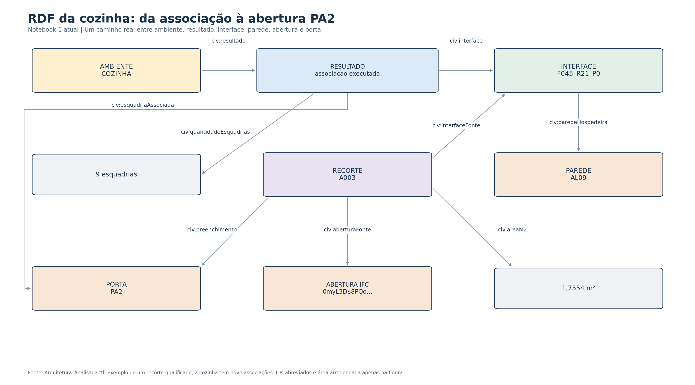

# RDF em caixas

As figuras retomam o estilo usado na apresentação: recursos em caixas coloridas, valores em cinza e predicados nas setas. Foram geradas novamente a partir de `Arquitetura_Analisada.ttl`, extraído do resultado atual do Notebook 1, com **80.234 triplas**.

| Figura | Conteúdo | Arquivos |
|---|---|---|
| Organização espacial | Terreno, edificação, dois pavimentos e os 41 ambientes. | [PNG](Organizacao_Espacial.png) · [SVG](Organizacao_Espacial.svg) · [RDF do recorte](Organizacao_Espacial.ttl) |
| Identidade da cozinha | Pertencimento ao pavimento, tipo, nome, nome descritivo, categoria e GlobalId. | [PNG](Cozinha_Identidade.png) · [SVG](Cozinha_Identidade.svg) · [RDF do recorte](Cozinha_Identidade.ttl) |
| Associação com PA2 | Um caminho real do resultado geométrico: ambiente → resultado → interface; parede, recorte, abertura e porta. | [PNG](Cozinha_Associacao_PA2.png) · [SVG](Cozinha_Associacao_PA2.svg) · [RDF do recorte](Cozinha_Associacao_PA2.ttl) |

O desenho seleciona triplas existentes. A disposição das caixas não representa a posição física dos elementos. A última figura mostra um recorte qualificado; a cozinha tem nove esquadrias associadas no critério, sem que todas recebam confirmação documental. A divergência de JA-09 continua descrita na análise dos resultados.

Na figura de identidade, as legendas simplificadas correspondem a estes predicados:

| Legenda | Predicado RDF |
|---|---|
| nome | `rdfs:label` |
| nome descritivo | `props:longNameIfcSpatialElement_attribute_simple` |
| categoria | `props:category_property_simple` |
| GlobalId | `props:globalIdIfcRoot_attribute_simple` |

`props:` corresponde a `http://lbd.arch.rwth-aachen.de/props#`; `civ:` corresponde ao [vocabulário deste estudo](../../codigo/Vocabulario.ttl). IDs longos e números foram abreviados/arredondados somente para exibição; os recortes Turtle mantêm as identidades e valores originais.

O [código utilizado](../../codigo/visualizar_rdf.py) usa RDFLib e Matplotlib, já presentes nas dependências do projeto. O Notebook 1 gera estas figuras depois de produzir o grafo.
