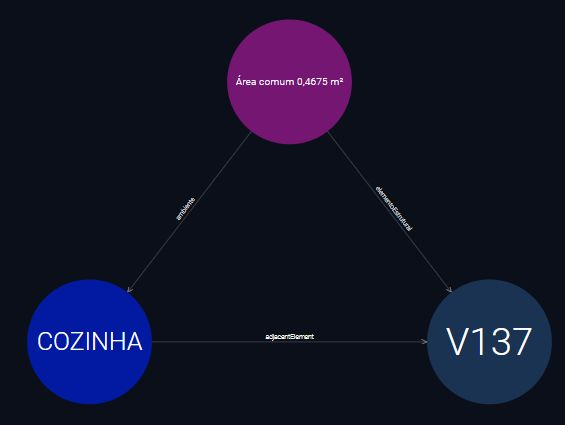

# Resultados de organização e exploração

Resultados primários produzidos pela execução completa do [Notebook 3](../../notebooks/03_Organizacao_e_Exploracao.ipynb), em 30/10/2026. Consulte o [método, referências e limitações](../../docs/Organizacao_e_Exploracao.md).

| Resultado | Evidência disponibilizada |
|---|---|
| 416.603 quádruplas, nove grafos; cinco grafos N2 preservados | [Dataset N-Quads ZIP](Dataset_Organizado.zip) · [Resumo](Resumo_Organizacao.json) |
| 9 Psets e 34 propriedades simples da V137 | [Registros e unidades JSON](Propriedades_V137.json) · [Grafo N-Triples](Propriedades_V137.nt) |
| Oito perguntas respondidas em SPARQL | [Consultas e respostas JSON](Consultas_Executadas.json) · CSVs nesta pasta · [código das consultas](../../codigo/consultas_exploracao/) |
| Contrato SHACL conforme na projeção documentada | [Resumo e alcance](Resumo_SHACL.json) · [Resultado de conformidade](Validacao_SHACL.ttl) |
| 26.601 produtos disponíveis para explorar; 394.067 quádruplas diretas no índice | [Aplicação publicada](https://prcgui.github.io/bim-ontology-CIV2155/) · [Resumo do índice](Resumo_Indice.json) |

As três salas inconclusivas continuam sem contagem, e a avaliação geométrica não foi ampliada. Os testes de regressão, mutações controladas, erros de desenvolvimento e demais auditorias ficam somente no Google Drive. O resultado SHACL acima é o resultado primário do contrato implementado, sem certificar a semântica global ou o projeto estrutural.

## Recorte visual da Cozinha e da viga V137

Captura nativa do GraphDB preparada para a figura do artigo a partir do dataset preservado acima. O recorte mostra três recursos e três triplas reais: a Cozinha aponta para a V137 por `bot:adjacentElement`, e o registro de relação espacial aponta para ambos por `int:ambiente` e `int:elementoEstrutural`. O rótulo do registro exibe **0,4675 m²**, calculado pela consulta de apresentação a partir de `int:areaContatoM2 = 0.4674837228519026`; não acrescenta uma tripla ao dataset. A posição dos nós não representa sua posição física, e a medida geométrica não demonstra, isoladamente, apoio estrutural.

A consulta Node basics fixa `?rank = 1.0` de modo uniforme para os três recursos, exclusivamente para ampliar o tamanho visual dos nós. Esse parâmetro de apresentação não expressa centralidade, relevância nem outro dado BIM e não acrescenta triplas ao dataset.

O [manifesto portátil](Cozinha_V137_GraphDB.json) registra os IRIs completos, as três triplas, as medidas originais e os hashes da imagem, do dataset e das consultas. Para reconstruir a visualização no GraphDB, use a [consulta 09](../../codigo/consultas_exploracao/09_cozinha_v137_visual_graphdb.rq) em Graph expansion e a [consulta 10](../../codigo/consultas_exploracao/10_rotulos_cozinha_v137_graphdb.rq) em Node basics, iniciando por um dos três IRIs do manifesto. Essas consultas de apresentação são adicionais às oito consultas executadas no N3.
